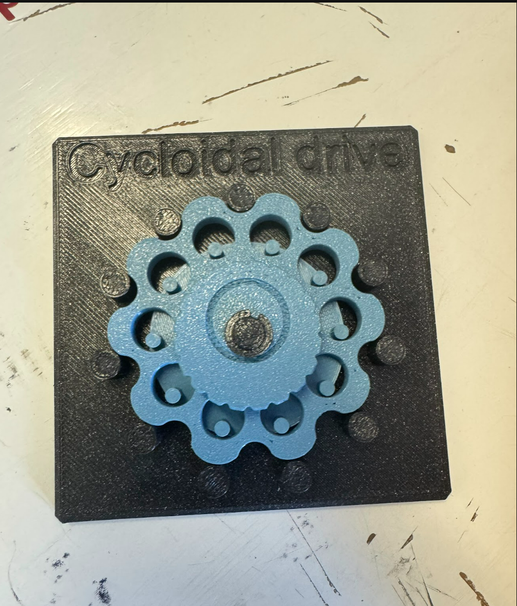
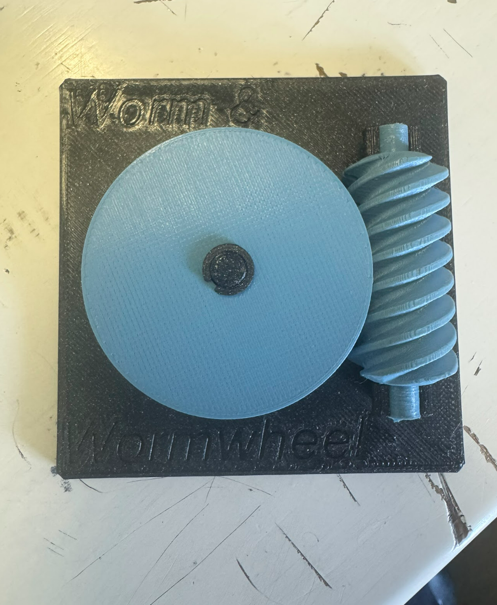
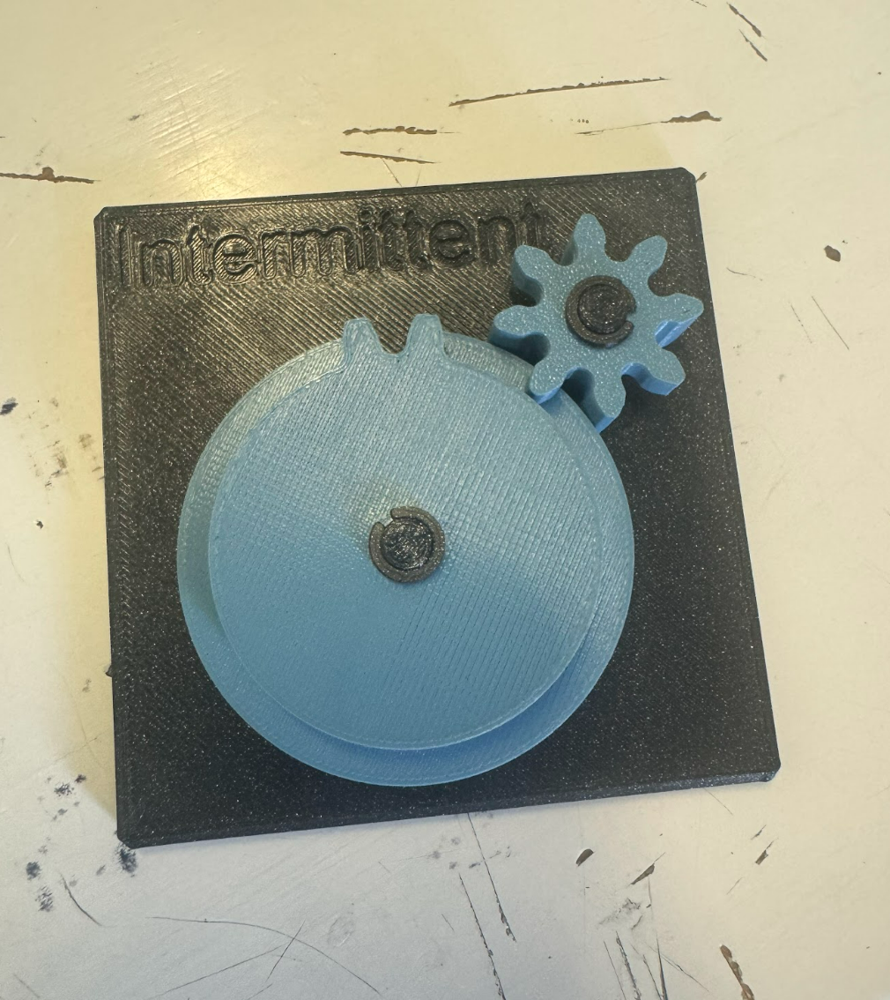
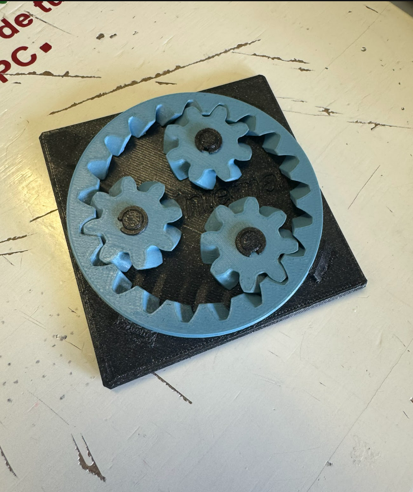
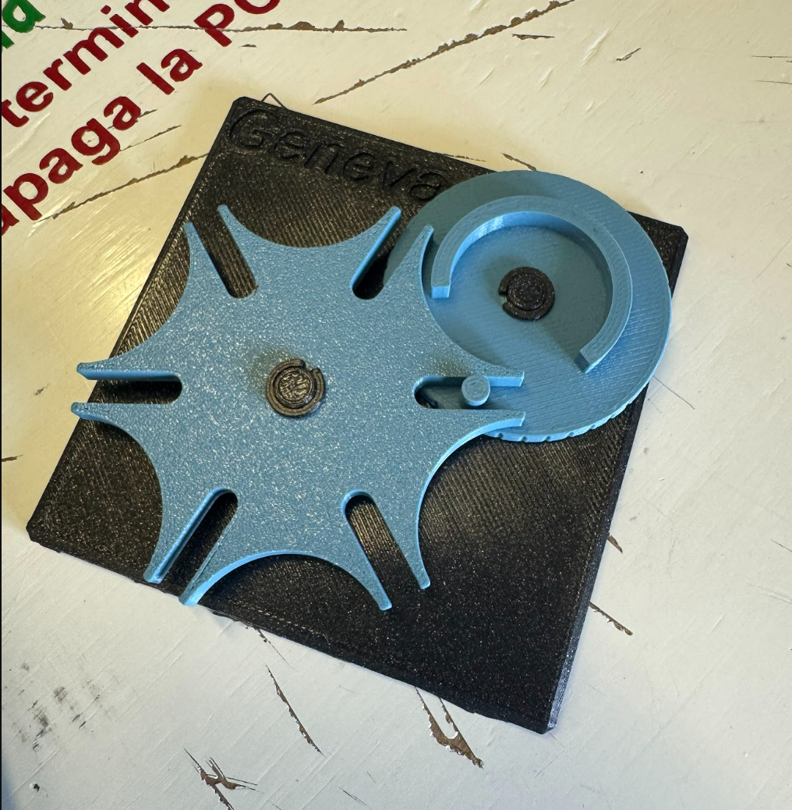
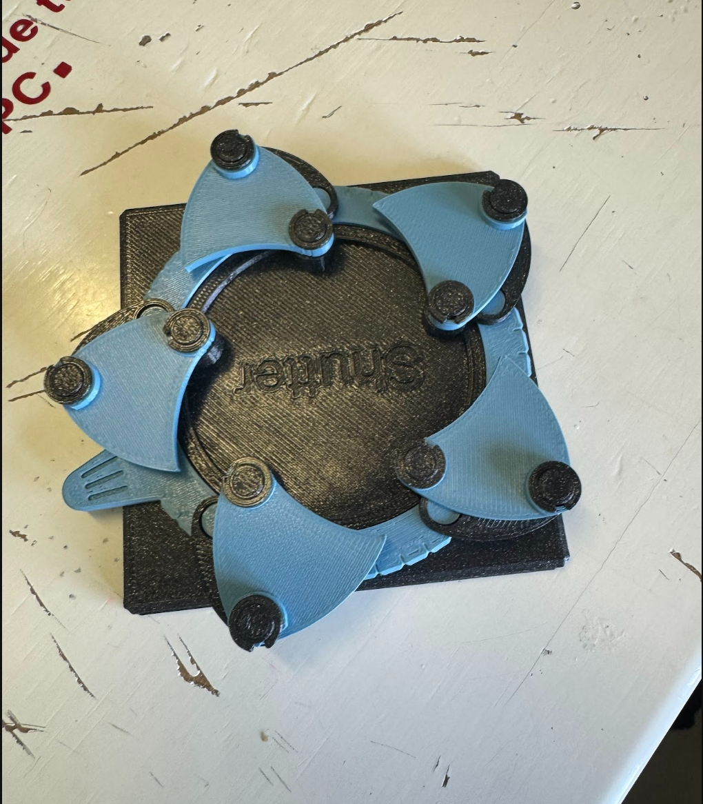
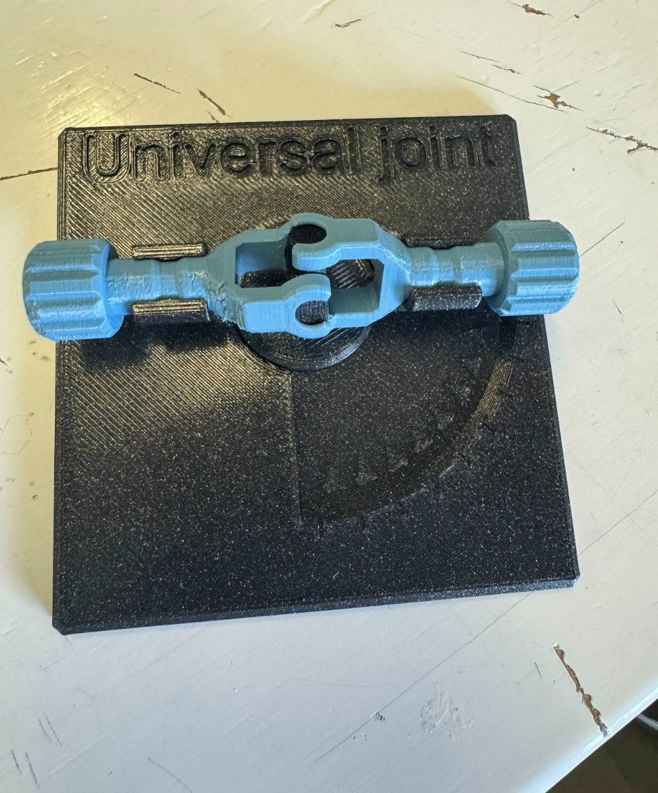
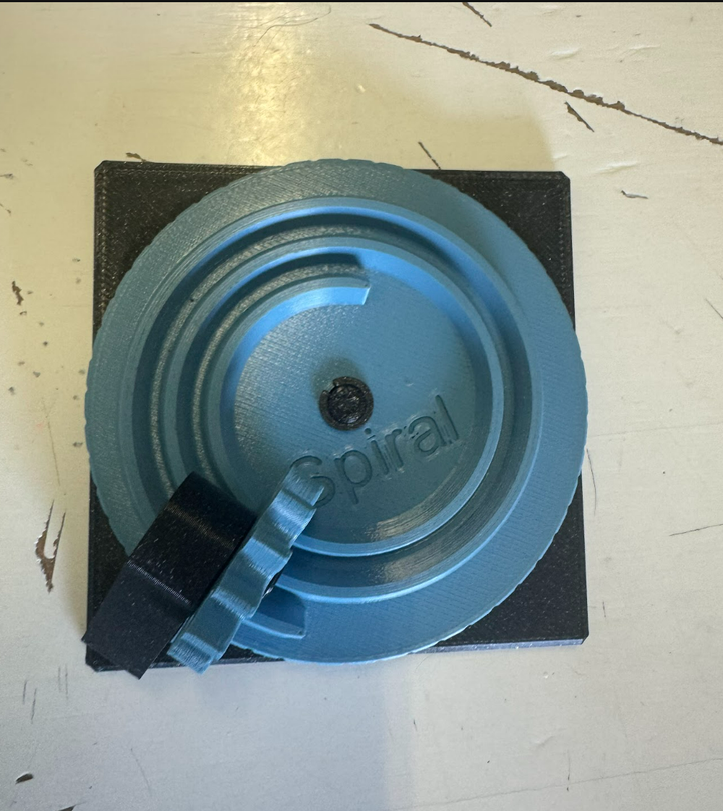

# Sesión 4 — Mecanismos
## Qué debía lograr hoy
Objetivo: Entender cómo los mecanismos transforman el movimiento (velocidad ↔ par, rotación ↔ traslación, continuo ↔ intermitente), calcular relaciones de transmisión simples y aplicarlo al tren motriz del carro — tocando mecanismos reales en un taller de estaciones.

Qué usé

- Libreta
- Pluma 

Primer mecanismo 

* **Descripción:** Es un reductor de velocidad epicicloidal que utiliza un disco con perfil de curva cicloidal en lugar de engranajes con dientes convencionales.
* **¿Qué transforma?** **Velocidad $\leftrightarrow$ Par (Torque):** Convierte la alta velocidad y bajo torque del eje de entrada en una baja velocidad de salida con un torque sumamente elevado.
* **Relación de transmisión ($i$):** **10 : 1**
  * *Cálculo:* $i = \frac{P - L}{L} = \frac{11 - 10}{10} = \frac{1}{10}$ (donde $P = 11$ pernos exteriores fijos y $L = 10$ lóbulos en el disco azul).
* **¿Reversible o autobloqueante?** **Autobloqueante** (la excentricidad del eje y la alta fricción impiden que la fuerza ejercida desde la salida mueva el motor de entrada).
* **¿Dónde lo has visto en la vida real?** En las articulaciones de brazos robóticos industriales y actuadores de precisión.
* **Aplicación práctica:**
  * *En el carro:* En el motor de dirección asistida o en sistemas de elevación de cristales de gran fuerza.
  * *En un proyecto:* En los actuadores articulados de un brazo robótico de 6 grados de libertad.

Segundo mecanismo 

### Segundo mecanismo: Tornillo Sin Fin y Corona (*Worm & Wormwheel*)

* **Descripción:** Conjunto cinemático formado por un tornillo cilíndrico helicoidal (sin fin) que engrana con una rueda dentada o corona circular a $90^\circ$.
* **¿Qué transforma?** **Cambio de eje a $90^\circ$ y Alta reducción de Velocidad $\leftrightarrow$ Par:** Transmite movimiento entre dos ejes ortogonales (perpendiculares) no salientes, reduciendo drásticamente la velocidad e incrementando el torque de salida.
* **Relación de transmisión ($i$):** **Depende del número de entradas del tornillo y dientes de la corona.**
  * *Fórmula:* $i = \frac{N_{\text{corona}}}{N_{\text{entradas}}}$. Para un tornillo de una sola entrada ($N = 1$), si la corona tiene 20 o 30 dientes, la relación es **20 : 1** o **30 : 1** (1 vuelta completa del tornillo avanza solo 1 diente de la rueda).
* **¿Reversible o autobloqueante?** **Autobloqueante** (debido al pequeño ángulo de hélice del tornillo y la fricción, el tornillo puede mover a la rueda, pero la rueda no puede hacer girar al tornillo).
* **¿Dónde lo has visto en la vida real?** En elevadores y ascensores.
* **Aplicación práctica:**
  * *En el carro:* En el motor del limpiaparabrisas o en el mecanismo del freno de mano eléctrico.
  * *En un proyecto:* En un sistema de elevación para un robot.

  ### Tercer mecanismo: Engranaje Intermitente (*Intermittent / Mutilated Gear*)

* **Descripción:** Sistema de dos ruedas donde el disco impulsor principal posee un par de dientes de empuje y un perfil cilíndrico de retención que engrana periódicamente con una rueda de 8 dientes[cite: 6].
* **¿Qué transforma?** **Continuo $\leftrightarrow$ Intermitente:** Transforma la rotación continua del disco de entrada en un movimiento pausado o intermitente en la salida[cite: 6].
* **Relación de transmisión ($i$):** **8 : 1**[cite: 6]
  * *Cálculo:* Por cada 1 vuelta completa ($360^\circ$) del disco de entrada, la rueda conducida de 8 dientes solo avanza 1 posición ($45^\circ$), lo que equivale a $\frac{1}{8}$ de vuelta[cite: 6].
* **¿Reversible o autobloqueante?** **Autobloqueante** (mientras no pasa el diente de empuje, el arco cilíndrico liso del disco bloquea físicamente la rueda conducida para evitar que gire libremente)[cite: 6].
* **¿Dónde lo has visto en la vida real?** En odómetros analógicos de automóviles clásicos (contadores de kilómetros mecánicos), temporizadores y sistemas de indexado[cite: 6].
* **Aplicación práctica:**
  * *En el carro del proyecto:* En un mecanismo de avance por pasos o contador de vueltas integrado al chasis, donde un motor accionado por Arduino mediante comandos enviados por Bluetooth activa un disparo mecánico o avance por posiciones.
  * *En un proyecto propio:* En una maquina de croquetas o dulces.

  ### Cuarto mecanismo: Tren de Engranajes Epicicloidal o Planetario (*Planetary / Epicyclic Gearbox*)

* **Descripción:** Sistema de engranajes formado por un sol central (engranaje de entrada), varios satélites o planetas (los 3 engranajes intermedios) montados sobre un porta-satélites y una corona exterior con dentado interno.
* **¿Qué transforma?** **Velocidad $\leftrightarrow$ Par (Torque):** Permite obtener altas reducciones de velocidad con un incremento proporcional de torque en un espacio extremadamente compacto y coaxial (ejes de entrada y salida alineados).
* **Relación de transmisión ($i$):** **Depende del elemento que se mantenga fijo y de los dientes del sol ($Z_s$) y la corona ($Z_c$).**
  * *Fórmula con corona fija:* $i = 1 + \frac{Z_c}{Z_s}$. Por ejemplo, si el sol central tiene 12 dientes y la corona exterior tiene 36 dientes, la relación de reducción es $i = 1 + \frac{36}{12} = 4 : 1$ (el sol da 4 vueltas para que el porta-satélites de salida dé 1).
* **¿Reversible o autobloqueante?** **Reversible** (se puede impulsar tanto desde el sol como desde el porta-satélites o la corona, dependiendo de qué elemento se deje libre o se bloquee).
* **¿Dónde lo has visto en la vida real?** En transmisiones automáticas de automóviles, destornilladores eléctricos / taladros inalámbricos y cajas reductoras de motores paso a paso o servomotores.
* **Aplicación práctica:**
  * *En un proyecto personal:* En las ruedas de un carrito robot para darle más fuerza de subida

### Quinto mecanismo: Rueda de Ginebra o Cruz de Malta (*Geneva Drive*)

* **Descripción:** Mecanismo compuesto por una rueda motriz con un pivote (perno) y un arco de bloqueo, y una rueda conducida que tiene varias ranuras radiales (en este caso 6 ranuras) donde entra el pivote.
* **¿Qué transforma?** **Continuo $\leftrightarrow$ Intermitente:** Convierte un movimiento de rotación continua en la entrada en un giro intermitente y pausado en la salida.
* **Relación de transmisión ($i$):** **6 : 1**
  * *Cálculo:* Como la estrella tiene $n = 6$ ranuras, por cada vuelta completa ($360^\circ$) del disco motor, la rueda conducida avanza 1 posición, es decir, $\frac{360^\circ}{6} = 60^\circ$ ($\frac{1}{6}$ de vuelta).
* **¿Reversible o autobloqueante?** **Autobloqueante** (mientras el pivote no está dentro de una ranura, la superficie circular del disco de entrada encaja con la curvatura de la estrella y la mantiene firmemente bloqueada).
* **¿Dónde lo has visto en la vida real?** En proyectores de cine analógicos para avanzar el rollo de película fotograma por fotograma, y en relojes mecánicos.
* **Aplicación práctica:**
  * *En un proyecto personal:* En una banda transportadora o mesa giratoria que avance plato por plato para llenar vasos o recipientes automáticamente uno a uno.

### Sexto mecanismo: Obturador de Iris o Mecanismo de Diafragma (*Aperture / Iris Shutter*)

* **Descripción:** Mecanismo compuesto por una serie de paletas o aspas traslapadas (en este caso 5 paletas) conectadas a un anillo rotatorio de control, el cual las desplaza de forma simultánea para variar el diámetro de una apertura central.
* **¿Qué transforma?** **Rotación $\leftrightarrow$ Apertura lineal/radial:** Transforma la rotación angular del anillo exterior en la apertura o cierre concéntrico del paso circular central.
* **Relación de transmisión ($i$):** **No aplica como relación de engranajes ($1 : 1$ angular).**
  * *Explicación:* Un pequeño giro angular del anillo externo (por ejemplo, $30^\circ$) desplaza proporcionalmente las 5 paletas abriendo o cerrando el diafragma por completo.
* **¿Reversible o autobloqueante?** **Reversible** (se puede mover girando el anillo accionador o manipulando manualmente una de las pestañas del mecanismo).
* **¿Dónde lo has visto en la vida real?** En cámaras fotográficas (control de entrada de luz y profundidad de campo), lentes de proyectores y válvulas de apertura regulable en ventilación industrial.
* **Aplicación práctica:**
  * *En un proyecto personal:* En una garra o pinza suave de agarre para un robot, o como un sistema para regular la salida de objetos o luz en una maqueta automatizada.

  ### Séptimo mecanismo: Junta Universal o Junta Cardán (*Universal Joint*)

* **Descripción:** Acoplamiento mecánico formado por dos horquillas unidas mediante una pieza en forma de cruz (cruceta), lo que permite conectar dos ejes que no están perfectamente alineados.
* **¿Qué transforma?** **Transmisión de rotación angular a diferente ángulo:** Transmite movimiento de rotación entre dos ejes que se cruzan formando un ángulo variable.
* **Relación de transmisión ($i$):** **1 : 1 (Nominal / Promedio)**
  * *Explicación:* Por cada vuelta completa del eje de entrada ($360^\circ$), el eje de salida da exactamente 1 vuelta completa ($360^\circ$), aunque la velocidad instantánea varía levemente si hay desalineación (fluctuación de velocidad angular).
* **¿Reversible o autobloqueante?** **Reversible** (se puede aplicar movimiento de rotación desde cualquiera de los dos ejes).
* **¿Dónde lo has visto en la vida real?** En la flecha o árbol de transmisión de camionetas y autos de tracción trasera, herramientas de extensión articuladas para llaves de dados y columnas de dirección de automóviles.
* **Aplicación práctica:**
  * *En un proyecto personal:* En la transmisión de un carrito para transmitir potencia a las ruedas aunque el chasis o la suspensión se muevan en terrenos irregulares.

### Octavo mecanismo: Mecanismo de Espiral o Leva en Espiral (*Spiral*)

* **Descripción:** Mecanismo compuesto por un disco con una canaleta o guía en forma de espiral de Arquímedes y un seguidor (palanca o piñón) que recorre la ranura a medida que el disco gira.
* **¿Qué transforma?** **Rotación $\leftrightarrow$ Desplazamiento radial/lineal:** Transforma el movimiento de rotación del disco en un avance lineal progresivo y uniforme del seguidor hacia afuera o hacia el centro.
* **Relación de transmisión ($i$):** **No aplica como relación de engranajes ($1 : 1$ por revolución).**
  * *Explicación:* El avance depende del paso de la espiral ($p$); por cada giro completo ($360^\circ$) del disco, el seguidor se desplaza linealmente una distancia fija equivalente al paso de la espiral.
* **¿Reversible o autobloqueante?** **Autobloqueante** (el disco en espiral puede mover y posicionar el seguidor, pero las fuerzas lineales aplicadas sobre el seguidor no pueden hacer girar el disco debido al ángulo de la guía y la fricción).
* **¿Dónde lo has visto en la vida real?** En mandriles o chucks de tornos mecánicos (para abrir y cerrar las garras simultáneamente), mecanismos de ajuste en herramientas y calibradores de precisión.
* **Aplicación práctica:**
  * *En un proyecto personal:* En una pinza o sujetador automático para un robot, donde al girar el disco o las garras se cierran o abren de forma centrada para agarrar objetos.
  